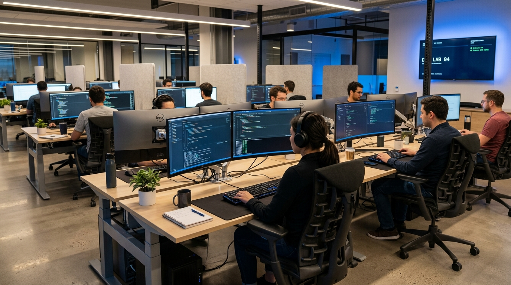

# 💻 K3Learn PPLG - Platform Pembelajaran & Kuis K3 Interaktif

K3Learn PPLG adalah aplikasi web edukasi modern untuk pembelajaran Keselamatan dan Kesehatan Kerja (K3) khusus bidang **Pengembangan Perangkat Lunak dan GIM (PPLG / RPL)** dengan sistem kuis interaktif dan skoring otomatis.



## ✨ Fitur Utama

- **📚 Katalog Kursus K3 PPLG Komprehensif:** 8 modul spesifik untuk IT/Software Engineering (Ergonomi Kerja Programmer, Kesehatan Mata & CVS, Keselamatan Listrik Lab, Proteksi Kebakaran APAR CO2, Anti-Burnout & Pomodoro, SOP & Budaya 5R Lab, Perakitan PC & Bahaya ESD, serta Ergonomi Lingkungan & Suhu AC).
- **📖 Pembelajaran Interaktif:** Panduan materi lengkap dengan ilustrasi modern, rumus sudut duduk 90°, aturan 20-20-20, dan protokol keselamatan lab komputer.
- **⏱️ Kuis Interaktif 10 Soal K3 PPLG:** Dilengkapi dengan timer 20 menit, visual progress bar, navigator soal melompat, tombol lewati, dialog konfirmasi submit, dan auto-advance.
- **📊 Skoring & Evaluasi Otomatis:** Perhitungan nilai real-time, lingkaran persentase animasi SVG, status kelulusan (Lulus/Belum Lulus), review kunci jawaban dengan pembahasan lengkap, serta rekomendasi materi tindak lanjut.
- **🎨 Desain Modern & Responsif:** Tema warna Navy Blue & Safety Orange/Cyber Blue, tipografi Plus Jakarta Sans, glassmorphism card, animasi halus, dan mobile-friendly layout.

## 🚀 Struktur Direktori

```text
├── index.html              # Landing Page / Beranda K3 PPLG
├── pages/
│   ├── kursus.html         # Halaman Katalog Kursus K3 PPLG
│   ├── materi.html         # Halaman Detail Materi Pembelajaran K3 PPLG
│   ├── kuis.html           # Halaman Kuis Interaktif 10 Soal K3 PPLG
│   └── hasil.html          # Halaman Hasil Skoring & Pembahasan Soal
├── assets/
│   ├── css/
│   │   └── style.css       # Design System & Styling K3Learn
│   └── images/             # Ilustrasi & visual materi keselamatan IT
└── README.md
```

## 💻 Cara Menjalankan Secara Lokal

Cukup buka file `index.html` langsung di browser atau melalui web server lokal:

```bash
# Melalui Laragon:
# http://localhost/kuis/

# Menggunakan Python
python -m http.server 8080

# Atau menggunakan npx serve
npx serve .
```
